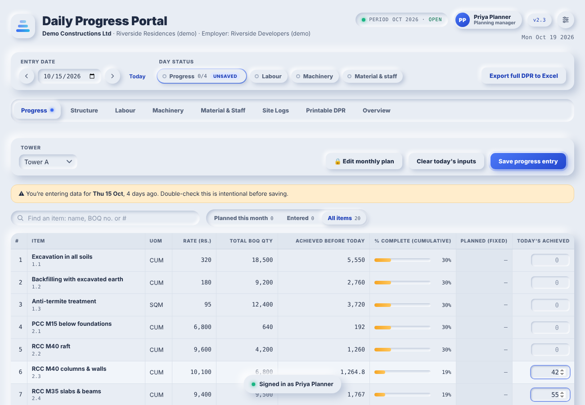

# DPR Portal

[](https://github.com/hereikeepmystuff-svg/DPR---Portal/actions/workflows/tests.yml)
[](https://github.com/hereikeepmystuff-svg/DPR---Portal/actions/workflows/android.yml)

An offline, single-file web app for a construction site's **daily progress report (DPR)**.

The planning manager sets the project up: BOQ, areas, floors and pours, the monthly plan and the project's own DPR workbook. Site engineers record each day's work:

- progress against the BOQ
- labour, machinery, and material & staff
- concrete pours, rain, hindrances and BBS checks

From those entries the portal produces a printable DPR, an overview with financial progress and an S-curve, and an Excel export. When a project workbook has been imported, the export is written back into that workbook in its own layout.

It is one HTML file, with nothing to install, and it works offline in Chrome or Edge on a laptop or a phone.

People on separate devices keep in step in one of two ways:
- through the project's SharePoint folder, where everyone signs in with their Microsoft work account (v3.0);
- with no server at all, by exchanging small setup and entries files.



## Try it

1. Download [`dist/dpr-portal.html`](dist/dpr-portal.html) and open it in a browser.
2. Choose **I'm the planning manager** and create your account. You will be shown a recovery code; keep it somewhere safe.
3. The demo project *Riverside Residences* is built in. Its names, rates and quantities are all made up. Pick a date and an area, enter some quantities and press **Ctrl+S**.

Everything you enter is kept in that browser on that device. To work as a team, see [Roles and sharing](docs/roles-and-sharing.md).

## SharePoint sync

The planning manager connects the project to a SharePoint folder once. Site engineers then open an invite link and sign in with their Microsoft work account. After that, the setup and everyone's entries stay in step by themselves:
- Each device keeps a full copy and works offline.
- The light at the top shows when everything is in step.
- SharePoint's folder permissions enforce who may change the setup.

Your IT team registers the portal with Microsoft 365 once beforehand, which takes about ten minutes. Browsers use the portal's website for this: https://hereikeepmystuff-svg.github.io/DPR---Portal/ (published by GitHub Pages once switched on). The Android app signs in by itself. See [docs/sharepoint.md](docs/sharepoint.md).

## Android app

The portal also comes as an Android app that works fully offline. It saves files to the phone's Downloads, where you can share them on WhatsApp or email. It opens setup and entries files straight from those apps, prints through Android, and fits phones and tablets of every size, upright or sideways.

GitHub builds the APK on every push (*Actions → Android app*) and attaches it to every release. Before the app goes onto site phones, set up the project's signing key, so that later versions install over it without losing data. See [docs/android.md](docs/android.md).

## What it does

**Daily entry**
- **Day status bar** for the chosen date: which areas have progress, and whether labour, machinery and material are saved. Click a chip to go to what's missing.
- **Progress, two ways:**
  - a searchable item list that can be filtered to the items planned this month;
  - a spreadsheet-style pour grid with Excel copy/paste, fill-down and undo.
- **Labour by crew and trade,** with contractor presets and "copy last day".
- **Machinery, material & staff,** prefilled from the last saved day.
- **Site logs:** concrete pours, rain, hindrances and BBS checks.
- **Keyboard and phone friendly:**
  - Enter and the arrow keys move down a list; **Ctrl+S** saves the tab you are on.
  - Tabs with unsaved changes are marked, and the portal asks before you leave them.
  - On phones, lists turn into cards and a floating Save button follows you down the page.
- **Soft checks** ask you to confirm an entry that pushes an item past its BOQ quantity, or that is ten times the day's plan.

**Roles and team**
- **Three roles:**
  - *Planning manager*: base data, plan, periods and the team.
  - *Site engineer*: daily entries, optionally limited to their own areas.
  - *View only.*
- Personal PINs or passwords, with a recovery code for planning managers.
- Every saved record notes who saved it and when.
- An optional screen lock for shared site-office computers.
- **No server needed:**
  - The planning manager sends a *setup file*.
  - Each engineer sends back an *entries file*.
  - The import keeps the newest version of each record and never counts anything twice.

**Fits any project**
- **Your own words:** Tower / Block / Building / Zone / Section, Level / Floor / Stage, Pour / Bay / Segment.
- **Your currency and number format:** rupees in crore or lakh, or dollars, dirhams, riyals, pounds or euro in millions, with Indian or international digit grouping.
- **Module switches:** turn off floors & pours, labour, machinery, material & staff, or any site log.
- **Paste the BOQ from Excel.**
- **Renaming an area moves everything recorded against it** to the new name.
- **Import any project's DPR workbook:** the wizard reads its layout, and exports write back into it, keeping formulas and formatting.

**Reports and control**
- A printable DPR for any date.
- An overview with financial progress, the S-curve and day-wise planned vs achieved.
- Month **close, reopen (with a reason) and roll-over** to next month's workbook.
- A fixed monthly plan with a change log.

## Documentation

| | |
|---|---|
| [User guide](docs/user-guide.md) | Setting up a project and making the daily entries, for planning managers and engineers |
| [Roles and sharing](docs/roles-and-sharing.md) | What each role can do, how setup and entries files move between devices, how merging works |
| [Architecture](docs/architecture.md) | How the single file is organised: storage, data model, workbook engine, entry tracking |
| [SharePoint sync](docs/sharepoint.md) | Setting up sync: the IT app registration, the planning manager's connection, engineers joining, the status light, troubleshooting |
| [Android app](docs/android.md) | Installing and updating the app, its signing key, what it adds on a phone, building it |
| [Development](docs/development.md) | Building, testing and releasing a new version |
| [Changelog](CHANGELOG.md) | What changed in each version |

## Repository layout

```
dist/dpr-portal.html         ready-to-use build with the demo project
src/portal.template.html     the application (HTML, CSS and JavaScript in one file); project data is injected at build time
src/seeds/demo.json          the demo project's data (invented)
src/modules/                 the modules added in v2.1–v3.0, as separate files for easier reading
tools/build.py               template + project seed (+ optional DPR workbook) -> a portal file
tools/extract_seed.py        pull the project data out of an existing portal file
tools/make_demo_seed.py      regenerates src/seeds/demo.json
tools/history/               the patch scripts that produced each version
tests/smoke_demo.py          end-to-end test of the demo build
tests/project/               deeper tests written against a project with its own DPR workbook
tests/sync_e2e.py            SharePoint sync end to end, against tests/mock_microsoft.py (a stand-in for Microsoft 365)
tests/android_*.py           the Android app's packing and bridge
android/                     the Android app: a WebView shell (Gradle project), bridge.js and prepare_assets.py
.github/workflows/            tests.yml (browser tests), android.yml (the APK), pages.yml (the website)
docs/                        guides and screenshots
```

## Your own project's portal

Project data (BOQ rates, quantities, subcontractors, the DPR workbook) is commercial information, so it lives in a *seed* file outside this repository. Seeds are kept in `seeds/private/`, which git ignores.

```bash
# from a portal file you already use
python3 tools/extract_seed.py my_project_portal.html --out seeds/private/my_project.json
python3 tools/build.py --seed seeds/private/my_project.json --out my_project_portal_v3.0.html

# embed or replace the project's DPR workbook
python3 tools/build.py --seed seeds/private/my_project.json --workbook "DPR.xlsx" --out my_project_portal_v3.0.html
```

A rebuilt file uses the same browser storage key as the one it came from, so it opens with all the data already entered on that device.

A brand-new project can also start from the demo build. In Settings, either import the project's DPR workbook (**Workbook & periods**) or paste the BOQ and list the areas (**Project**, **BOQ & lists**).

## Good to know

- **Data stays on the device.** Entries are saved in the browser's storage and the project workbook in its IndexedDB, and clearing browsing data deletes them.
  - With SharePoint sync on, everything is also in the project's SharePoint folder.
  - Without it, make regular full backups (Settings → Data), and use entries files to collect everyone's work in the planning manager's copy.
- **Roles.** The portal keeps people to their job and records who did what. On its own, that is a browser-side safeguard. With SharePoint sync, the folder's permissions enforce the roles on the server too: engineers can be given edit access to the entries folder only.
- **Excel export:**
  - With a project workbook imported, exports are built inside the browser and work offline.
  - The summary workbook (used when no project workbook has been imported) loads SheetJS from cdnjs, so it needs an internet connection.
- **Browsers:** current Chrome, Edge and Safari. Printing is not available inside the claude.ai viewer; open the file directly in a browser to print or save the DPR as a PDF.
