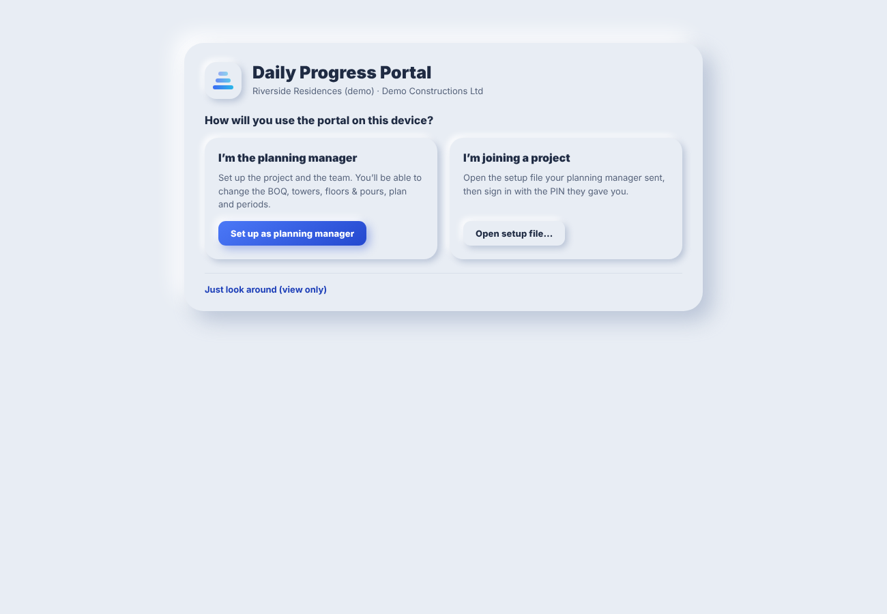
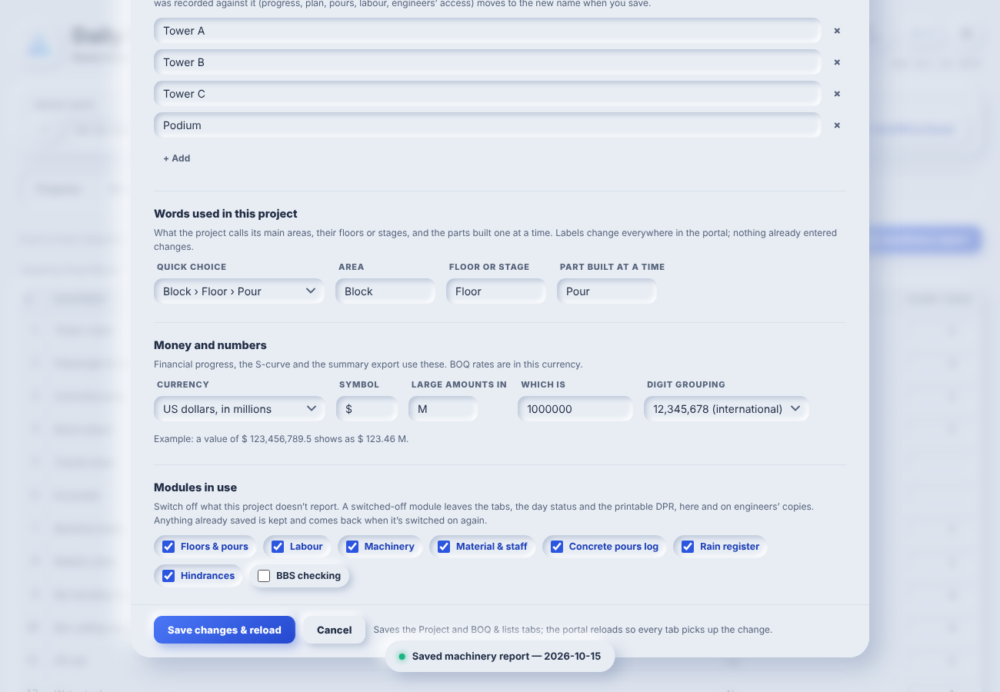
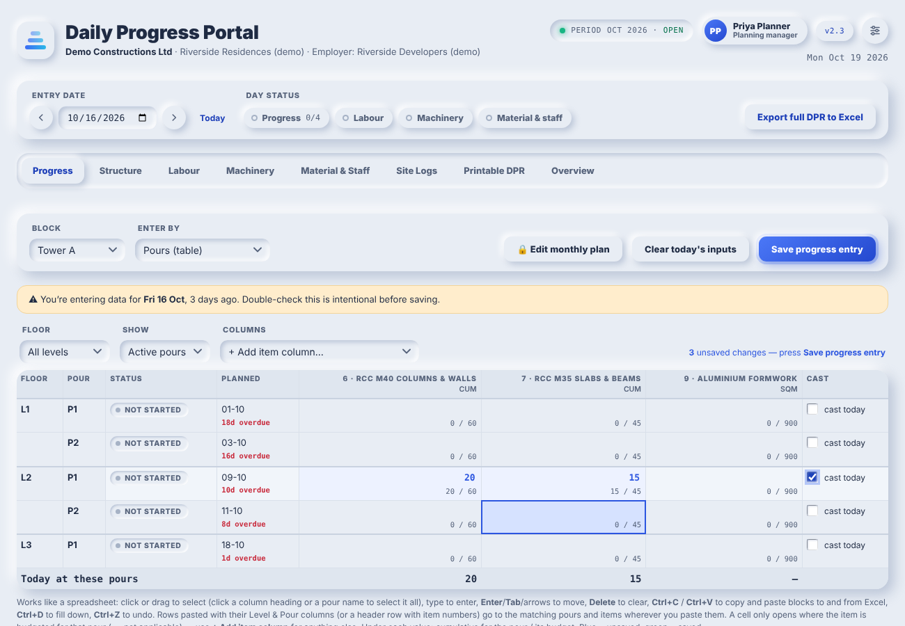
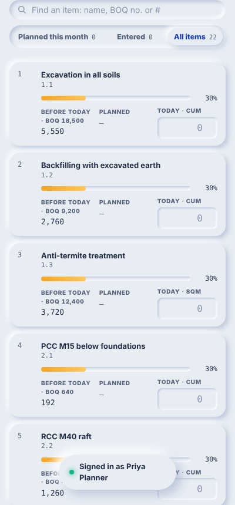
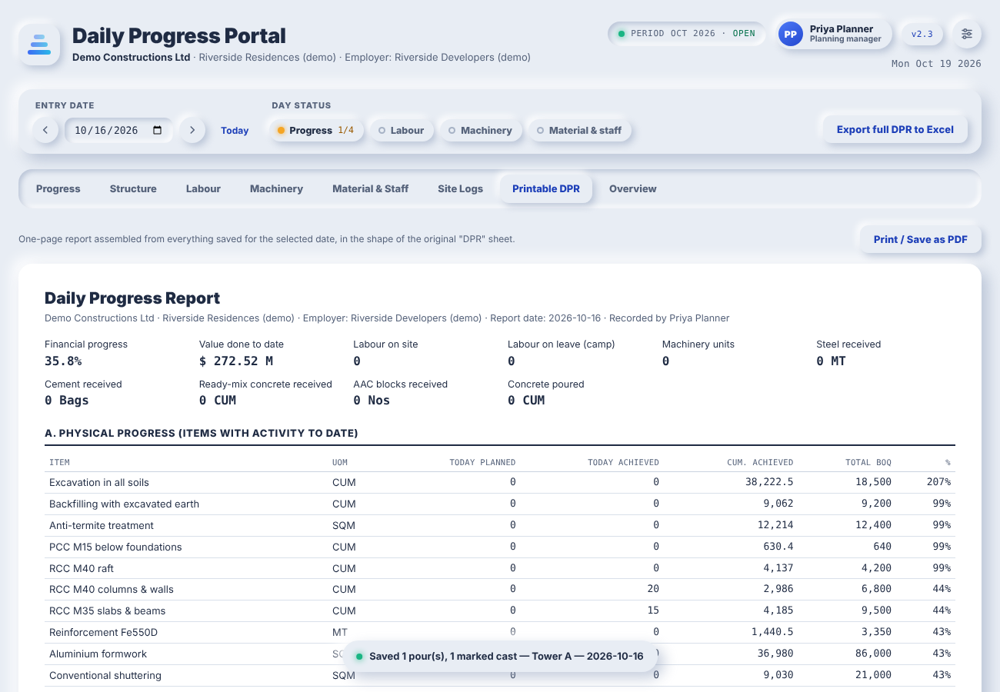

# User guide

This guide follows the year of a project: the **planning manager** sets it up, **site engineers** make daily entries, and the portal turns those entries into the DPR. The labels below use the default words (Tower, Level, Pour). If the project uses its own words, such as Block, Floor and Bay, the screens use those instead.

- [1. First run](#1-first-run)
- [2. Setting up the project (planning manager)](#2-setting-up-the-project-planning-manager)
- [3. The team](#3-the-team)
- [4. Daily entry](#4-daily-entry)
- [5. Reports and exports](#5-reports-and-exports)
- [6. Month end: closing and rolling over](#6-month-end-closing-and-rolling-over)
- [7. Keyboard shortcuts](#7-keyboard-shortcuts)
- [8. Backups and moving to a new device](#8-backups-and-moving-to-a-new-device)

## 1. First run

Open the portal file in Chrome or Edge. The welcome screen offers three choices:

- **I'm the planning manager.**
  1. Create your account with your name and a password of at least six characters.
  2. The portal then shows a **recovery code**. Keep it somewhere outside the portal. It is the only way to reset a forgotten planning-manager password when no other planning manager can do it.
- **I'm joining a project.** For engineers. Open the setup file the planning manager sent you, then sign in with the PIN they gave you.
- **Just look around.** View only. Nothing can be changed.

After that, opening the file shows the sign-in screen. Pick your name and enter your PIN or password. **Stay signed in on this device** skips the sign-in next time on a personal device; leave it off on a shared computer.

## 2. Setting up the project (planning manager)

Open **Settings** with the sliders button at the top right. Planning managers see six tabs.

### From an existing DPR workbook (recommended)

Go to **Workbook & periods** → **Import a project workbook…**

1. Choose the project's DPR workbook (.xlsx).
2. The wizard reads its layout: BOQ items, towers, the row of daily dates, the cumulative column, and the labour, machinery and log sheets. It suggests a mapping.
3. Check the preview, which shows the item count, the towers and the first items with their baseline quantities. Adjust any column the wizard got wrong.
4. Enter the contractor, project and employer names, then choose **Set up project**.

From then on, **Export full DPR to Excel** writes each day's figures back into this workbook, keeping all its formulas and formatting.

### By hand, without a workbook

1. Under **Project**:
   - Fill in the contractor, project and employer.
   - List the towers (or blocks, zones…), one per line.
   - Choose the **words**, **money** format and **modules** (see below).
2. Under **BOQ & lists** → **Paste from Excel…**:
   - Copy the BOQ rows in Excel, including the heading row if you have one, and paste them in.
   - With headings, the columns can be in any order: BOQ no., Description, Unit, Quantity, Rate.
   - Rows without a unit, quantity or rate are taken as section headings and left out.
   - Choose **Add new items, update ones with the same BOQ no.** or **Replace the whole list**.
3. On the same tab, check the machinery types, material items, staff roles, labour trades (day shift, night shift, extra roles) and concrete grades.
4. Press **Save changes & reload**.

### Words, money and modules (Settings → Project)

- **Words used in this project.** What the project calls its main areas, their floors or stages, and the parts built one at a time.
  - Pick a quick choice (Tower › Level › Pour, Block › Floor › Pour, Section › Stage › Segment…) or type your own.
  - The labels change everywhere: tabs, tables, the printable DPR and exports.
- **Money and numbers.**
  - Choose the currency and the unit for large amounts: rupees in crore or lakh, millions for other currencies, or your own unit.
  - Choose Indian (1,23,45,678) or international (12,345,678) digit grouping.
  - The example line shows the result before you save.
- **Modules in use.** Untick what this project doesn't report: floors & pours, labour, machinery, material & staff, concrete pours, rain, hindrances or BBS checks.
  - A switched-off module disappears from the tabs, the day status and the printable DPR.
  - Data already saved is kept and comes back if you switch the module on again.

**Renaming a tower** keeps everything recorded against it. Edit its name in the list and save. Progress, the plan, pours and cast dates, labour rows and engineers' access all move to the new name. Exports still find the tower in the project workbook under its original label.

### Floors and pours

Use this to track individual pours (or bays, segments…) instead of whole towers. In **Floors & pours**:

1. Paste a table with a heading row:

   | Tower | Level | Pour | Planned date | 13 | 28 |
   |---|---|---|---|---|---|
   | Tower A | L1 | P1 | 05-10-2026 | 120 | 14 |

   The numbered columns are optional budget quantities, headed by BOQ item number (*13* or *13 Shuttering*) or BOQ ID.
2. List the levels from the bottom up. That order drives the cycle-time figures on the Structure tab.
3. Press **Check**, then **Apply**.

**Download blank template** gives a CSV to fill in.

### The monthly plan

On the Progress tab, **Edit monthly plan** (planning managers only) opens a grid of items by days for one tower and month.

- Type or paste the planned quantities from Excel and press **Save plan changes**.
- Every change is listed under *Recent plan changes* with who made it and when.
- Engineers see the plan read-only next to what they enter.

## 3. The team

**Settings → Team & access**:

- **People.**
  - **+ Add person:** name, role and sign-in.
    - Site engineers get a 4–8 digit PIN, suggested for you.
    - Planning managers get a password of six or more characters.
  - For an engineer, tick the towers they enter progress for. Leave all unticked to allow every tower.
  - **Can enter site-wide reports** lets them fill in labour, machinery, material & staff and the site logs. Untick it for someone who should enter progress only.
  - **New PIN** sets a fresh PIN when someone forgets theirs.
  - **Remove** stops a person signing in. Their saved entries stay, still marked with their name.
- **Who can do what.** The full permissions table. See [Roles and sharing](roles-and-sharing.md).
- **Share with engineers.**
  1. **Save setup file** packs everything an engineer's copy needs: BOQ, towers, floors & pours, plan, periods, the team and its PINs, and the project workbook. Tick *Include everyone's entries so far* so their cumulative figures are complete. Send the file by email, WhatsApp or a shared folder.
  2. **Import entries files…** brings engineers' work in. You can pick several files at once. A preview shows what's new, updated, the same or newer on your copy before anything is merged.

  After any change to the base data, the card warns you to send a new setup file.
- **Recovery code.** Create a new one if the old one may have been seen.
- **Shared computers.** Lock the screen after 5–60 minutes without use. Unlocking needs the same person's PIN or password, and anything typed but not saved is kept. "Not you? Sign in as someone else" switches person, which discards the previous person's unsaved typing after a warning.
- **Recent activity.** Who saved, imported or changed what on this device.

## 4. Daily entry

### Choose the day

The bar at the top holds the **entry date**: step a day with ‹ ›, or press **Today**. Beside it, the **day status** shows what is saved for that date:

- **Progress 3/9**: towers with progress saved. Click it to list the towers still missing and jump to one. Saving an empty list for a tower counts as "nothing today".
- **Labour**, **Machinery**, **Material & staff**: green once saved for the day.
- **Concrete** and **Rain**: shown when the logs have entries for the day.

A blue ring and **unsaved** mean something was typed but not saved.

The portal warns about past dates ("27 days ago") and future dates. Days recorded in the project workbook, and days in a closed month, are shown read-only.

### Progress

Choose the **tower**. If it has pours set up, **Enter by** switches between two ways of working:

- **Whole tower (item list).** One line per BOQ item, showing quantity done before today, the % complete bar, today's plan and a box for today's quantity.
  - **Find an item** searches by name, BOQ number or #.
  - **Planned this month** shows only items with a plan this month, plus anything already entered. **Entered** shows what you've typed today. **All items** shows everything.
  - **Enter** or **↓** moves to the next item.
  - An entry that pushes an item past its BOQ quantity turns amber, and you're asked to confirm when saving. So is an entry ten times the day's plan.
- **Pours (table).** A spreadsheet: one row per pour, one column per item budgeted in the tower's pours.
  - Click or drag to select, type to enter, **Enter**/**Tab**/arrows to move, **Delete** to clear.
  - **Ctrl+C**/**Ctrl+V** copy and paste blocks to and from Excel, **Ctrl+D** fills down and **Ctrl+Z** undoes.
  - Under each value: the cumulative for the pour against its budget.
  - Tick **cast today** when a pour is cast.
  - **Show** hides pours already cast or planned more than two weeks ahead; **Columns** adds any other item.

Press **Save progress entry** or **Ctrl+S**. The line under the toolbar shows who saved last, and when.

### Labour

One row per contractor crew on site, with head counts per trade for the day and night shifts.

- **Load all presets**, or pick one with **+ Add selected**, to add the usual crews. Presets are managed by planning managers.
- On a day with nothing saved yet, **Copy the crews from …** (or **Copy last day**) brings in the last saved day's crews, with or without the counts.
- **Labour at camp** records workers on leave, separately from labour on site.
- Empty rows aren't saved.

### Machinery, material & staff

Machinery counts and staff numbers start from the last saved day; check them and save. Material received is entered fresh each day, with a remark if needed.

### Site logs

Running logs that aren't tied to the date at the top. New rows start on the entry date.

- **Concrete pours**: date, tower, structure (suggested from the pour list), grade and quantity. A row that names a pour marks it cast.
- **Rain register**: start, end, intensity and the work affected.
- **Hindrances**: what, since when, until when or ongoing.
- **BBS checking**: bar bending schedule checks with quantities certified.

### On a phone

The item list and labour table turn into cards with large number boxes. When the tab's Save button scrolls out of sight while something is unsaved, a floating **Save** button appears at the bottom right.

### Sending your entries (engineers)

Open the menu under your name at the top right → **Send my entries…**.

1. Choose the date range. It starts from where you last sent.
2. Press **Save file** and send the file to the planning manager.

Sending the same days again is safe: the import keeps the newest version of each record.

When the planning manager sends a new setup file, open it from **My account** → **Open setup file…**. Your entries are kept.

## 5. Reports and exports

- **Printable DPR**: a one-page report for the entry date. It covers financial progress and value done, physical progress by item, labour (with labour at camp), machinery, staff, concrete poured, rain, hindrances in force, BBS checks and who recorded the day. Sections follow the modules in use. To print or save as PDF, open the portal file directly in a browser; the claude.ai viewer blocks printing.

- **Overview**:
  - financial progress overall and by tower;
  - labour, machinery and material for the day;
  - cumulative item progress;
  - the S-curve of planned and achieved value;
  - a day-wise planned vs achieved table.
- **Export full DPR to Excel** (top bar):
  - With a project workbook imported, the portal writes every portal entry into it (daily progress, plan, labour, machinery and logs), keeping formulas and formatting, and names the file after the project and date.
  - Without one, it builds a summary workbook: progress summary, financial and day-wise sheets, and logs.

  If anything was typed but not saved, you're asked first.

## 6. Month end: closing and rolling over

**Settings → Workbook & periods → Periods** (planning managers):

- **Close period** freezes every entry dated in the month (progress, plan, labour, machinery, material and site logs) and records the closing cumulative quantities. It first lists any days with no progress entered.
- **Reopen period** asks for a reason, which is logged.
- **Roll over** (after closing) prepares next month's workbook. It:
  - writes the month into the workbook;
  - shifts the date columns to the next month;
  - clears the daily cells;
  - writes the closing cumulative quantities into the "achieved till" column;
  - updates month labels in the headers.

  Formulas and other sheets stay as they are.
- If the workbook's dates aren't one continuous run, prepare next month's workbook yourself and load it with **Use next month's workbook instead**.

## 7. Keyboard shortcuts

| Keys | Where | What |
|---|---|---|
| Ctrl+S | anywhere | Save the tab you are on |
| Enter, ↓ / Shift+Enter, ↑ | number lists | Next / previous row in the same column |
| / | Progress item list | Jump to the item search |
| Esc | item search | Clear the search |
| Arrows, Enter, Tab | pour grid | Move the selection |
| Ctrl+C, Ctrl+X, Ctrl+V | pour grid | Copy, cut, paste blocks (to and from Excel) |
| Ctrl+D | pour grid | Fill down |
| Ctrl+Z | pour grid | Undo |
| Ctrl+A, F2, Delete | pour grid | Select all, edit cell, clear |

## 8. Backups and moving to a new device

Everything lives in the browser on the device where it was entered. Planning managers should keep regular backups:

- **Settings → Data → Export full data backup** saves everything on the device: setup, team, entries and history. **Import full data backup** either merges it in or replaces what's there.
- **Export this configuration only** carries a project's setup to a genuinely new project, without entries or the team.
- **Start a blank project** and **Reset to the built-in project data** clear all daily entries in this browser, but keep the team.

**Moving to a new device.**

1. On the old device, save a setup file with everyone's entries: Team & access → **Save setup file**, with *Include everyone's entries so far* ticked.
2. On the new device, open the portal file, choose **I'm joining a project**, open that setup file, and sign in with your usual password.

A full data backup also works, and carries the activity log too:

1. On the new device, set up a temporary planning-manager account.
2. Go to Settings → Data → **Import full data backup** → **Replace everything**.
3. Sign in with your usual password.
